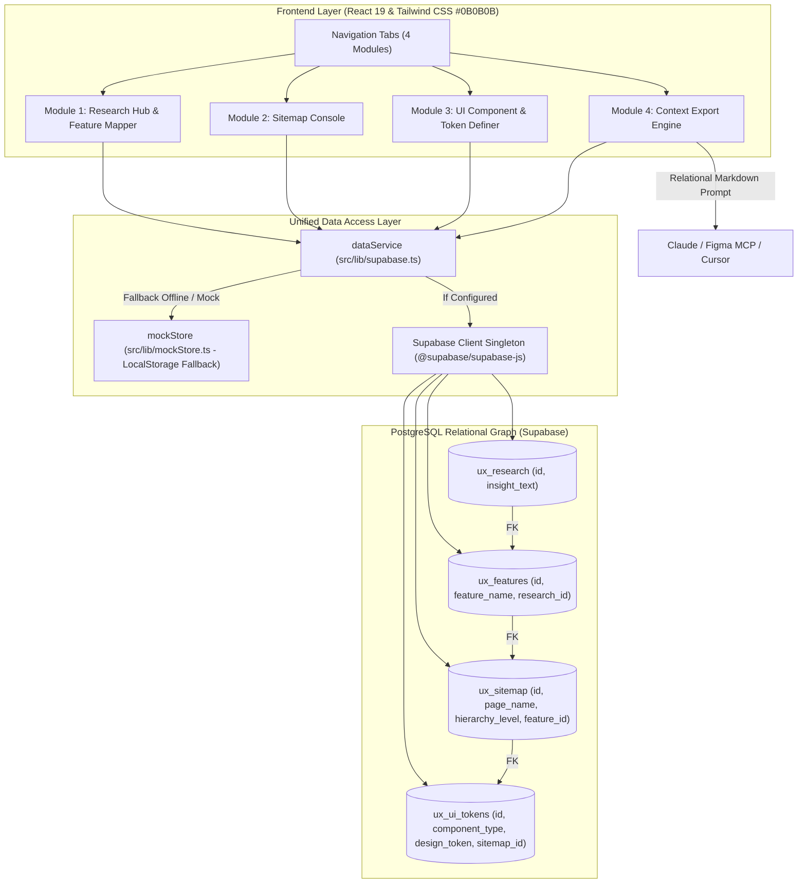

# Frontend Architecture: UX Logic Thread (Traceability Mapper)

## 1. Ringkasan Arsitektur
UX Logic Thread dibangun menggunakan **React 19**, **Vite**, **TypeScript (Strict Mode)**, **Tailwind CSS**, dan **Supabase Client**. Aplikasi dirancang dengan filosofi *zero-friction*, performa tinggi, dan kepatuhan penuh terhadap **70 Vercel React Best Practices**.



---

## 2. Struktur Modul & Komponen

| Modul | File Komponen | Tanggung Jawab | Relasi Data |
| :--- | :--- | :--- | :--- |
| **Shell & Header** | `src/components/Header.tsx` | Branding, dark editorial bar `#0B0B0B`, indikator status Supabase / Mock, reset data | - |
| **Tabs Navigation** | `src/components/NavigationTabs.tsx` | Navigasi 4 modul dengan counters | - |
| **Module 1: Research Hub** | `src/components/ResearchHub.tsx` | Input instan keluhan riset (&lt;15s) dan registrasi fitur baru | `ux_research` &rarr; `ux_features` (`research_id`) |
| **Module 2: Sitemap Console** | `src/components/SitemapConsole.tsx` | Penempatan fitur pada halaman & tingkat hierarki (Header, Hero, Main, Modal, Floating, Footer) | `ux_features` &rarr; `ux_sitemap` (`feature_id`) |
| **Module 3: UI & Token Definer** | `src/components/TokenDefiner.tsx` | Ikatan komponen (Card, Accordion, Toast) dan variabel token ke node sitemap | `ux_sitemap` &rarr; `ux_ui_tokens` (`sitemap_id`) |
| **Module 4: Context Export** | `src/components/ContextExport.tsx` | Kueri relasional hulu-ke-hilir untuk menghasilkan Markdown System Prompt | Graph query hulu-hilir (FK chain) |

---

## 3. Penerapan Vercel React Best Practices

1. **Eliminating Waterfalls (CRITICAL):**
   - Data fetching pada `loadAllData()` dan `getFullTraceability()` menggunakan `Promise.all()` untuk melakukan query paralel 4 tabel sekaligus, mencegah serial chain blocking.
2. **Re-render Optimization:**
   - Input instan diisolasi ke komponen terpisah (`InstantResearchInput`) sehingga keystroke pengguna tidak memicu re-render pada daftar riset utama.
   - Pemanfaatan `useMemo` dengan O(1) Map indexing (`featuresByResearch`, `sitemapMap`, `featureMap`) alih-alih nested `.find()` di setiap baris.
   - Menggunakan functional updates `setState((prev) => [...])` untuk referensi handler yang stabil.
   - State diturunkan (*derived state*) langsung saat render tanpa sinkronisasi buatan via `useEffect`.
3. **Bundle Size & Direct Imports:**
   - Menghindari barrel files. Import komponen dilakukan langsung dari jalurnya.
   - Lucide icons diimpor secara spesifik.
4. **Resilient Offline / Mock Mode:**
   - Fallback otomatis ke `mockStore` berbasis `localStorage` jika variabel environment `VITE_SUPABASE_URL` belum diisi.
   - Developer dapat langsung mendesain alur benang merah out-of-the-box tanpa konfigurasi eksternal terlebih dahulu.

---

## 4. Skema Database Relasional (Supabase)

```sql
-- 1. Tabel Insight Riset Pengguna
CREATE TABLE IF NOT EXISTS ux_research (
  id UUID PRIMARY KEY DEFAULT gen_random_uuid(),
  insight_text TEXT NOT NULL,
  created_at TIMESTAMPTZ DEFAULT now()
);

-- 2. Tabel Fitur (Relasi ke Riset)
CREATE TABLE IF NOT EXISTS ux_features (
  id UUID PRIMARY KEY DEFAULT gen_random_uuid(),
  feature_name TEXT NOT NULL,
  description TEXT,
  research_id UUID NOT NULL REFERENCES ux_research(id) ON DELETE CASCADE,
  created_at TIMESTAMPTZ DEFAULT now()
);

-- 3. Tabel Sitemap & Arsitektur Hierarki (Relasi ke Fitur)
CREATE TABLE IF NOT EXISTS ux_sitemap (
  id UUID PRIMARY KEY DEFAULT gen_random_uuid(),
  page_name TEXT NOT NULL,
  hierarchy_level TEXT NOT NULL,
  feature_id UUID NOT NULL REFERENCES ux_features(id) ON DELETE CASCADE,
  created_at TIMESTAMPTZ DEFAULT now()
);

-- 4. Tabel Komponen UI & Design Tokens (Relasi ke Sitemap)
CREATE TABLE IF NOT EXISTS ux_ui_tokens (
  id UUID PRIMARY KEY DEFAULT gen_random_uuid(),
  component_type TEXT NOT NULL,
  design_token TEXT NOT NULL,
  sitemap_id UUID NOT NULL REFERENCES ux_sitemap(id) ON DELETE CASCADE,
  created_at TIMESTAMPTZ DEFAULT now()
);
```

---

## 5. Cara Menjalankan

```bash
# Development Server
npm run dev

# Typecheck & Production Build
npm run build

# Preview Production Build
npm run preview
```
