# Audit UX Berbasis Peak-End Rule: UX Logic Thread
**Produk:** UX Logic Thread (Traceability Mapper) — `d:\MindMap`  
**Auditor:** Product Researcher (Spesialisasi: Behavioral Psychology & Cognitive Ergonomics)  
**Tanggal:** 2026-11-05  
**Metodologi:** Peak-End Rule Heuristic (Kahneman & Fredrickson), Cognitive Load Theory, & Monochromatic Engineering Design Standard (Linear / Raycast)  
**Status:** LAPORAN AUDIT & SPESIFIKASI INTERVENSI KOMPREHENSIF — SIAP EKSEKUSI  

---

## 1. Ringkasan Eksekutif & Mandat Audit

### 1.1 Premis Psikologis: Apa itu Peak-End Rule?
Dalam psikologi perilaku (*behavioral economics*), **Peak-End Rule** (Kahneman, 1993; Fredrickson & Kahneman) menyatakan bahwa manusia **tidak mengevaluasi suatu pengalaman berdasarkan total durasi atau rata-rata matematis dari setiap detik yang dihabiskan**, melainkan ditentukan secara dominan oleh dua titik krusial:
1. **The Peak (Puncak Emosi):** Titik intensitas emosional tertinggi (positif atau negatif) selama perjalanan.
2. **The End (Akhir Perjalanan):** Kesan emosional yang tertinggal tepat saat tugas dinyatakan selesai atau ditutup.

```
       Tingkat Kepuasan Emosional (Valence)
         ▲
         │                  [ IDEAL PEAK ]
         │               "Sirkuit Silsilah Utuh!"
         │                        ▲
         │                       / \
         │                      /   \             [ IDEAL END ]
         │    [ 01 ]           /     \         "Pre-Flight Lolos &
         │    Riset           /       \          Prompt Tersalin"
         │     ┌───┐    [ 02 ]         \    [ 04 ]      ▲
         │     │   │────►Fitur          \───►Token──────┘
         ├─────┴───┴─────────────────────────────────────────► Waktu (Tahapan)
         │  [ REALITA SAAT INI: Flatline Monoton / Prosedural ]
         │  ──────────── ─── ─── ─── ─── ─── ─── ─── ─── ────►
         ▼
```

### 1.2 Masalah Fundamental UX Logic Thread Saat Ini
UX Logic Thread telah berhasil dieksekusi secara teknis dan estetik pasca-remediasi anti-slop:
- Memiliki kanvas bebas *clutter* berbasis React Flow (`@xyflow/react`).
- Mengadopsi palet monokromatik editorial bersih (standar Linear / Raycast).
- Menghilangkan *gradient slop* dan *glow halo* murahan.

Namun, **secara psikologis, alur kerja (workflow) aplikasi saat ini berada dalam kondisi "Emotional Flatline" (garis datar)**:
1. **Tidak Ada Puncak Emosi (Zero Peak):** Ketika seorang desainer berhasil menghubungkan mata rantai ke-4 dari Riset ke Fitur, Sitemap, hingga Token Desain, **tidak ada respons visual atau haptic yang menandakan keberhasilan intelektual tersebut**. Garis hanya menempel mati, dan kartu token hanya menampilkan titik kecil statis.
2. **Akhir yang Antiklimaks (Utilitarian End):** Saat membuka *AI Prompt Export Drawer*, pengguna hanya disajikan blok kode monokromatik dan tombol *copy* standar. Ketika tombol diklik, hanya ada teks "Tersalin!" selama 2 detik lalu hening. Tidak ada validasi integritas (*pre-flight verification*), tidak ada ringkasan dampak (*hours saved*), dan tidak ada instruksi serah-terima (*actionable next step*).
3. **Zona Datar & Friksi Kognitif:** Transisi dari formulir modal ke kanvas terputus (tanpa *echo* konteks induk), dan status belum terhubung (*unlinked*) terasa seperti kartu hukuman (*punitive warning*) daripada ruang draf kreatif.

Laporan audit ini memetakan seluruh perjalanan 5 tahap, membongkar titik mati emosi, dan menyusun **spesifikasi intervensi presisi tinggi tanpa merusak integritas desain monokromatik**.

---

## 2. Pemetaan Perjalanan Saat Ini (Current Journey Map across 5 Stages)

Aplikasi memiliki alur hulu-ke-hilir 5 tahap:
`01 Riset` ➔ `02 Fitur` ➔ `03 Sitemap` ➔ `04 Token UI` ➔ `05 Ekspor Konteks AI`.

```mermaid
flowchart LR
    Stage1["01. Akar Riset\n(Input Masalah)"] -->|Petakan Solusi| Stage2["02. Fitur Logika\n(Solusi Produk)"]
    Stage2 -->|Tentukan Layar| Stage3["03. Sitemap Layar\n(Struktur IA)"]
    Stage3 -->|Tautkan Token| Stage4["04. Token UI\n(CSS & Komponen)"]
    Stage4 -->|Ctrl+Shift+E| Stage5["05. Ekspor AI\n(Prompt Compiler)"]

    style Stage1 fill:#EEF2FF,stroke:#6366F1,stroke-width:2px,color:#1E1B4B
    style Stage2 fill:#F0FDF4,stroke:#10B981,stroke-width:2px,color:#064E3B
    style Stage3 fill:#FAF5FF,stroke:#A855F7,stroke-width:2px,color:#3B0764
    style Stage4 fill:#FFFBEB,stroke:#F59E0B,stroke-width:2px,color:#451A03
    style Stage5 fill:#18181B,stroke:#27272A,stroke-width:2px,color:#FFFFFF
```



### 2.1 Analisis Detail Setiap Tahap

| Tahap | Tujuan Pengguna | Tindakan Antarmuka | Beban Kognitif | Emosi Saat Ini (-5 s/d +5) | Titik Mati / Friksi yang Ditemukan |
| :--- | :--- | :--- | :--- | :--- | :--- |
| **01. Riset (`ResearchNode`)** | Menanamkan observasi empiris / komplain pengguna sebagai fondasi absolut. | Klik "+ Riset" di dock atau load workspace. Isi textarea formulir modal. | **Tinggi (Reflektif)**: Merangkum wawancara pengguna ke dalam 1–2 kalimat tajam. | **+1 (Datar)** | Modal langsung menutup tanpa animasi transisi. Node muncul di koordinat kanvas tanpa *pulse*, tanpa konfirmasi toast. Pengguna ragu apakah data tersimpan ke database/local store. |
| **02. Fitur (`FeatureNode`)** | Menghubungkan *pain point* menjadi solusi fitur konkret. | Klik "+ Petakan Fitur" di kartu riset atau via dock. Pilih induk di dropdown, isi nama & deskripsi. | **Tinggi (Kreatif)**: Berpikir "Bagaimana cara menyelesaikan komplain ini?". | **+2 (Cukup)** | Jika dibuat mandiri tanpa induk, muncul badge kuning oranye `Belum Terhubung` yang memberi kesan "salah/cacat". Di dalam modal, teks kutipan riset induk tidak ditampilkan, memaksa pengguna mengingat kembali. |
| **03. Sitemap (`SitemapNode`)** | Menempatkan fitur ke dalam hierarki antarmuka (Header, Hero, Body, Modal). | Klik "+ Tempatkan di Sitemap" di kartu fitur. Masukkan nama layar & level hierarki. | **Sedang (Struktural)**: Memetakan zonasi tata letak aplikasi. | **+1 (Mulai Lelah)** | Mulai terasa seperti tugas entri data administratif jika memetakan banyak layar sekaligus. Tidak ada *auto-suggest* nama layar standar (Dashboard, Settings, Onboarding). |
| **04. Token UI (`TokenNode`)** | Merumuskan aturan implementasi teknis (nama komponen & token Tailwind). | Klik "+ Tautkan Token UI". Mengisi tipe komponen `<Tag />` dan token desain CSS. | **Tinggi (Teknis)**: Menerjemahkan kebutuhan visual ke kode siap pakai. | **+2 (Antisipasi)** | **POTENSI PEAK YANG GAGAL**: Menghubungkan node ini melengkapi rantai 4 tahap. Namun sistem hanya menampilkan teks pasif `Ujung Rantai Logika (Siap Ekspor)` dan titik hijau 1.5px. Nol perayaan. |
| **05. Ekspor AI (`AIPromptExportDrawer`)** | Mengambil dividen dari seluruh kerja keras: Prompt deterministik untuk AI Vibe Coding. | Klik tombol `Ekspor Konteks AI` di top bar atau shortcut `Ctrl+Shift+E`. | **Rendah (Penerima Hasil)**: Ingin segera menguji prompt di Claude/Cursor. | **+2 (Antiklimaks)** | **POTENSI END YANG DINGIN**: Drawer terbuka, pengguna melihat *wall of code*. Klik "Salin Prompt", tombol berubah menjadi "Tersalin!" selama 2 detik. Tidak ada validasi kelengkapan, tidak ada apresiasi waktu kerja yang dihemat. |

---

## 3. Analisis Puncak Emosi (The Climax / Peak Moment Audit)

### 3.1 Mengapa Perjalanan Saat Ini Terasa Flat & Prosedural?
Desainer dan arsitek produk menggunakan UX Logic Thread bukan untuk menggambar grafik bebas layaknya Miro atau Figma; mereka menggunakannya untuk **membuktikan justifikasi logika**:
> *"Komponen tombol warna amber ini ada di layar Batch Panel karena riset #1 membuktikan pengguna sering menghapus data tanpa sengaja."*

Ketika rantai logika 4 tingkat berhasil dirajut lengkap:
1. `UXResearch` (Masalah)
2. `UXFeature` (Solusi)
3. `UXSitemap` (Penempatan)
4. `UXUIToken` (Implementasi Kode)

**Itu adalah momen kemenangan intelektual (*The Aha! Eureka Moment*)**. Di titik inilah desainer merasa: *"Arsitektur saya solid, tak terbantahkan, dan siap koding!"*.

### 3.2 Realita di Lapangan (Canvas Reality Check)
Mari kita lihat apa yang terjadi di kode `MindMapCanvas.tsx` saat koneksi terakhir dibuat (`onConnect`):
```tsx
// Cuplikan MindMapCanvas.tsx baris 997–1002
else if (source.startsWith('site-') && target.startsWith('tok-')) {
  const siteId = source.replace('site-', '');
  const tokId = target.replace('tok-', '');
  await onUpdateTokenParent(tokId, siteId);
}
```
Hasil visualnya:
- Garis bezier abu-abu tipis (`#A1A1AA`) muncul dengan panah standar.
- Kartu Token berubah teks footer dari `Belum Terhubung` menjadi `Ujung Rantai Logika (Siap Ekspor)`.
- **Tidak ada suara haptic mikro.**
- **Tidak ada kilatan energi/cahaya sepanjang lintasan dari hulu ke hilir.**
- **Tidak ada indikator di Top Bar yang merayakan penambahan silsilah utuh baru.**

Ini adalah kegagalan puncak (*The Flattened Peak*). Pengguna telah mendaki gunung kognitif, tetapi di puncaknya tidak ada bendera kemenangan.

---

## 4. Analisis Titik Akhir (The Ending Experience Audit)

### 4.1 Apa yang Terjadi di Tahap Ekspor Saat Ini?
Di `AIPromptExportDrawer.tsx`:
1. Pengguna membuka drawer via tombol top bar atau `Ctrl+Shift+E`.
2. Pengguna disajikan selektor tab target AI (`Claude`, `Cursor`, `Figma MCP`).
3. Pengguna menekan tombol:
   ```tsx
   <button onClick={handleCopy} className="...">
     {copied ? <Check /> <span>Tersalin!</span> : <Copy /> <span>Salin Prompt</span>}
   </button>
   ```
4. State `copied` aktif selama 2000ms, lalu tombol kembali ke tulisan "Salin Prompt".
5. Pengguna menutup drawer via tombol silang atau `Esc`.

### 4.2 Tiga Dosa Emosional pada Titik Akhir (Ending Sins)
Berdasarkan prinsip behavioral design:
1. **Absence of Closure (Ketiadaan Ritual Penutup):**
   Aplikasi kerja tingkat tinggi (seperti Linear, GitHub PR merge, atau Raycast script finish) memberikan *closure ritual*—perasaan bahwa pekerjaan telah tuntas dengan sempurna. UX Logic Thread memperlakukan proses ekspor seperti sekadar menyalin string dari clipboard biasa.
2. **Ketiadaan Validasi Integritas (Zero Pre-flight Confidence):**
   Pengguna tidak diberi tahu apakah graph mereka memiliki *orphan nodes* (node yatim/terputus) atau apakah silsilahnya 100% lengkap. Pengguna pergi dengan keraguan: *"Apakah ada fitur yang kelupaan tadi?"*.
3. **The Dead-End Drop-off (Jalan Buntu Tanpa Langkah Selanjutnya):**
   Setelah prompt disalin, antarmuka tidak memberikan instruksi lanjutan yang cerdas (misalnya: panduan cara paste ke Claude 3.7 dengan Figma MCP, atau instruksi menyimpan sebagai `.cursorrules`). Pengguna dibiarkan mandiri tanpa pendampingan akhir.

---

## 5. Inventarisasi Zona Datar & Titik Friksi Kognitif (Flat Zones & Friction Points)

Berikut adalah 6 zona datar kritis yang teridentifikasi dalam audit teknis dan pengalaman pengguna:

### Friksi 1: Layar Awal Tanpa Panduan (*The Sterile Blank Canvas*)
- **Lokasi File:** `src/components/canvas/MindMapCanvas.tsx`
- **Gejala:** Jika pengguna baru membuka kanvas kosong atau menekan hapus semua node, kanvas hanya menampilkan kisi titik-titik abu-abu (`BackgroundVariant.Dots`).
- **Dampak Psikologis:** *Blank page syndrome*. Pengguna tidak tahu harus memulai dari mana (apakah dari dock bawah atau klik kanan).
- **Temuan Kode:** Tidak ada komponen *EmptyState* atau *Onboarding Walkthrough Card*.

### Friksi 2: Amnesia Konteks pada Formulir Modal Anak (*Upstream Context Blindness*)
- **Lokasi File:** `src/components/canvas/AddNodeModal.tsx` (baris 185–205)
- **Gejala:** Saat pengguna mengklik tombol aksi cepat di kartu riset `+ Petakan Fitur`, modal terbuka dengan dropdown induk otomatis terisi ID riset tersebut. Namun, modal **hanya menampilkan dropdown teks yang terpotong 70 karakter**:
  ```tsx
  <option key={r.id} value={r.id}>
    {r.insight_text.slice(0, 70)}...
  </option>
  ```
- **Dampak Psikologis:** Pengguna tidak bisa membaca konteks riset secara utuh saat mengetik nama fitur baru. Ini memutus benang merah logika yang sedang dipikirkan.

### Friksi 3: Stigmatisasi Node Mandiri (*The Punitive "Belum Terhubung" Badge*)
- **Lokasi File:** `src/components/canvas/nodes/FeatureNode.tsx`, `SitemapNode.tsx`, `TokenNode.tsx`
- **Gejala:** Kartu yang baru dibuat tanpa induk langsung dilabeli badge oranye menyala:
  ```tsx
  <span className="text-[10px] font-mono text-amber-700 bg-amber-50 px-1.5 py-0.5 rounded border border-amber-200/80">
    Belum Terhubung
  </span>
  ```
- **Dampak Psikologis:** Memberi sinyal "Anda berbuat salah" atau "Data rusak". Padahal dalam proses eksplorasi desain, sering kali desainer ingin meletakkan ide komponen terlebih dahulu (*brain dump*) sebelum merangkai kabel koneksinya.

### Friksi 4: Penghitung Jalur di Top Bar Berupa "Angka Mati" (*Static Pipeline Tally*)
- **Lokasi File:** `src/components/canvas/CanvasTopBar.tsx` (baris 48–81)
- **Gejala:** Top bar menampilkan penghitung monokrom:
  `Riset 2 / Fitur 2 / Sitemap 2 / Token UI 2`.
- **Dampak Psikologis:** Angka-angka ini tidak menceritakan **kesehatan silsilah (*Lineage Health*)**. Mengetahui ada 2 riset dan 2 token tidak memberi tahu apakah keduanya terhubung menjadi 2 silsilah utuh, atau 4 kartu tercerai-berai. Tidak ada rasa progres yang memuaskan saat angka bertambah.

### Friksi 5: Aksi Pemutusan Kabel Terasa Dingin (*Cold Severance*)
- **Lokasi File:** `src/components/canvas/edges/ThreadEdge.tsx` (baris 45–70)
- **Gejala:** Saat kabel dipilih, tombol `[× Putuskan]` muncul melayang. Ketika diklik, kabel lenyap seketika tanpa jeda transisi atau mikrogelombang pemutusan.
- **Dampak Psikologis:** Kurang terasa organik; pengguna terkadang kaget apakah aksi mereka sengaja atau tidak sengaja memutus data di Supabase.

### Friksi 6: Salin Prompt Tanpa Pembuktian Kualitas (*Blind Clipboard Action*)
- **Lokasi File:** `src/components/canvas/AIPromptExportDrawer.tsx` (baris 237–256)
- **Gejala:** Tombol salin hanya beralih ikon. Tidak ada konfirmasi ukuran byte yang disalin, tidak ada pratinjau statistik prompt yang menunjukkan seberapa komprehensif instruksi yang dihasilkan.

---

## 6. Spesifikasi Intervensi UX Konkret (Sesuai Standar Anti-Slop Monokromatik)

Intervensi ini dirancang dengan prinsip: **Elegansi Monokromatik (Linear/Raycast) — Tanpa Warna Pelangi, Tanpa Konfeti Menor, dan Menggunakan Copywriting Bahasa Indonesia yang Bersahabat & Profesional**.

```
Prinsip Intervensi UX:
[ BUKAN: Konfeti ungu-pink murahan / Pop-up game ]
                     ▼
[ MELAINKAN: Kilatan sirkuit monokromatik, getaran tipografis halus,
             sertifikat integritas logika, dan kejelasan status ]
```

---

### 6.1 Intervensi Puncak (The Peak Climax): "Circuit Ignition" (Penyalaan Sirkuit Lengkap)

#### A. Mekanisme & Logika Pemicu
Puncak pengalaman (*The Peak*) diaktifkan tepat saat **sebuah rantai 4-tingkat lengkap terbentuk untuk pertama kalinya atau saat silsilah baru tersambung penuh** (`Research -> Feature -> Sitemap -> Token`).

#### B. Visual Crescendo Tanpa Slop
1. **Lintasan Cahaya Putih Obsidian (Wave Propagation):**
   - Garis kabel penghubung (`ThreadEdge`) sepanjang silsilah yang baru saja lengkap mengalami lonjakan animasi kilau (*monochromatic luminous pulse*):
     - Durasi: 600ms.
     - Warna: `#FFFFFF` (solid ink glow tipis `drop-shadow(0 0 4px rgba(255,255,255,0.8))`).
     - Gelombang bergerak mengalir dari kiri (`Research`) ➔ tengah ➔ kanan (`Token`).
2. **Transformasi Kartu Terminal (Token Card Celebration):**
   - Kartu Token penerima kabel terakhir berkedip halus dengan ring 1px putih-ke-zinc (`border-zinc-900 ring-2 ring-zinc-900/20`).
   - Teks footer kartu bertransformasi dengan transisi halus:
     - Semula: `Ujung Rantai Logika (Siap Ekspor)`
     - Menjadi: `✓ Silsilah 100% Utuh — Siap Kompilasi` (dengan dot hijau zamrud yang berdenyut tenang 1 kali).
3. **Audio-Haptic Bersih (Opsional via Web Audio API Synthesizer):**
   - Bukan suara lonceng kasino, melainkan suara mekanikal lembut (frekuensi 580Hz ➔ 880Hz, durasi 40ms, *soft sine decay* mirip suara klik keyboard haptic mekanik Apple/Linear).
4. **Notifikasi Toast Melayang Tenang (Quiet Toast):**
   - Muncul di pojok kanan bawah selama 3.5 detik:
     > **⚡ Silsilah Logika Terhubung Penuh**  
     > *Riset "#Pengguna bingung..." kini terikat sempurna hingga token desain. Siap diekspor ke AI.*

---

### 6.2 Intervensi Titik Akhir (The End Climax): "Traceability Pre-Flight & Handshake Protocol"

Saat pengguna membuka `AIPromptExportDrawer`, tahap ini diubah dari sekadar "penampil teks mentah" menjadi **"Upacara Serah Terima Arsitektur Produk"**.

#### A. Kartu Inspeksi Pra-Terbang (Pre-Flight Integrity Card)
Di bagian atas drawer (sebelum blok teks markdown), hadirkan kartu ringkasan audit logika berdesain editorial:

```
┌────────────────────────────────────────────────────────────────────────┐
│  ⚡ AUDIT KELENGKAPAN SILSILAH UX                         STATUS: PRIMA │
├────────────────────────────────────────────────────────────────────────┤
│  Skor Integritas: 100% Sempurna                                       │
│  • 2 Jalur Silsilah Hulu ke Hilir Utuh                                │
│  • 0 Node Yatim / Terputus                                            │
│  • Estimasi Waktu Wireframing Manual Dihemat: ~3.5 Jam Kerja           │
└────────────────────────────────────────────────────────────────────────┘
```

Jika terdapat node mandiri yang belum terhubung, kartu secara objektif memberi tahu:
> *ℹ️ 92% Integritas: 1 Layar Sitemap belum diikat ke fitur solusi. Sistem tetap menyertakannya dalam bagian "Komponen Mandiri" agar AI mengetahuinya.*

#### B. Transformasi Tombol "Salin Prompt" (Tactile Affirmation)
Saat tombol salin diklik:
1. Tombol mengalami animasi kompresi taktil (`scale-[0.98] ➔ scale-100`).
2. Teks berubah menjadi:
   - Baris 1: `✓ Prompt Berhasil Disalin!`
   - Baris 2 (subteks kecil): `Teks spesifikasi lengkap siap ditempelkan di Claude / Cursor`
3. Muncul banner panduan cepat di dasar drawer (*Quick-Start Handoff*):
   > **Langkah Selanjutnya:**
   > 1. Buka Claude 3.7 (aktifkan Figma MCP) atau Cursor Composer (`Ctrl+I`).
   > 2. Tempel prompt ini (`Ctrl+V`) sebagai System Directive awal.
   > 3. AI akan langsung mengonstruksi komponen tanpa perlu iterasi wireframe manual.

---

### 6.3 Intervensi Zona Datar (Eliminating Flat Zones)

#### Intervensi F1: Layar Awal Interaktif (*Guided First-Step Empty State*)
Jika kanvas kosong:
- Tampilkan *watermark card* minimalis di tengah kanvas (dengan garis putus-putus abu-abu tipis `#D4D4D8`):
  > **Kanvas Logika Masih Kosong**  
  > Mulai arsitektur Anda dengan meletakkan insight riset pertama, atau klik tombol **Muat Ulang Sampel Data** di sudut kanan atas untuk melihat contoh alur kerja lengkap.  
  > `[ + Tanamkan Riset Pertama ]` `[ ↺ Muat Sampel ]`

#### Intervensi F2: Upstream Context Echo pada Modal Anak
Di `AddNodeModal.tsx`:
- Saat pengguna memilih `nodeType === 'feature'` dan telah memiliki induk riset terpilih, tampilkan kotak kutipan konteks di bawah label:
  ```tsx
  <div className="rounded-lg bg-zinc-50 border border-zinc-200/80 p-3 text-xs text-zinc-600 italic">
    <span className="text-[10px] font-mono font-semibold uppercase text-indigo-600 not-italic block mb-1">
      Menjawab Akar Riset:
    </span>
    "{selectedResearchText}"
  </div>
  ```
- Ini menghilangkan amnesia kognitif dan membuat desainer merasa sedang menyambung benang logika asli.

#### Intervensi F3: Reframing Bahasa "Belum Terhubung" Menjadi "Draf Lepas"
Ganti label peringatan:
- Dari: `Belum Terhubung` (kesan salah/cacat)
- Menjadi: `Draf Lepas (Belum Bertaut)` (kesan tahap persiapan kreatif yang valid).

#### Intervensi F4: Meteran Kesehatan Silsilah di Top Bar (*Lineage Health Pill*)
Ubah deretan angka statis di `CanvasTopBar.tsx`:
- Dari: `Riset: 2 / Fitur: 2 / Sitemap: 2 / Token UI: 2`
- Menjadi:
  ```
  [ ● 2 Silsilah Lengkap ] · [ 4 Node Terhubung ] · [ Integritas: 100% ]
  ```
- Indikator dot berwarna hijau zamrud berkedip halus saat silsilah baru tercapai.

---

### 6.4 Matriks Penyesuaian Copywriting (Tone of Voice: Bersahabat, Profesional, Berwibawa)

| Area Antarmuka | Teks Lama (Kering / Prosedural) | Teks Rekomendasi Baru (Empowering & Jelas) | Rasional Psikologis |
| :--- | :--- | :--- | :--- |
| **Top Bar Export Button** | `Ekspor Konteks AI` | `Kompilasi Prompt AI` | Kata "Kompilasi" menegaskan bahwa sistem merangkum kerja keras relasional, bukan sekadar tombol unduh biasa. |
| **Top Bar Tooltip Auto-Layout** | `Tata letak otomatis` | `Rapikan Formasi Kanvas Otomatis` | Menggunakan istilah arsitektural yang berwibawa. |
| **Node Riset Footer** | `Akar Silsilah` | `01 Akar Masalah (Ground Truth)` | Menegaskan kembali peran riset sebagai fondasi yang tak terbantahkan. |
| **Node Fitur Footer (Unlinked)** | `Belum Terhubung` | `Draf Mandiri (Tautkan ke Riset)` | Memberikan instruksi tindakan persuasif daripada label pasif. |
| **Node Token Footer (Complete)** | `Ujung Rantai Logika (Siap Ekspor)` | `✓ Silsilah Utuh (Siap Koding)` | Mengaitkan langsung dengan keuntungan akhir pengguna: siap koding! |
| **Edge Disconnect Button** | `Putuskan` | `Lepas Hubungan` | Lebih elegan dan profesional daripada istilah kasar "Putuskan". |
| **Export Drawer Header** | `Pusat Ekspor Konteks AI` | `Studio Kompilasi Konteks AI` | Mengangkat status mental pengguna dari "penyalin teks" menjadi "arsitek di studionya". |
| **Export Drawer Copy Button** | `Salin Prompt` ➔ `Tersalin!` | `Salin Spesifikasi AI` ➔ `✓ Siap Digunakan di Cursor/Claude!` | Memberi konfirmasi tujuan yang jelas dan meyakinkan. |

---

## 7. Peta Jalan Implementasi Terprioritas (Prioritized Implementation Roadmap)

Strategi ini membagi pekerjaan ke dalam 3 gelombang terukur, mengutamakan perbaikan cepat (*quick wins*) yang memberikan lompatan kepuasan terbesar.

```
       DAMPAK EMOSIONAL PENGGUNA
          ▲
          │   [ QUICK WINS: GELOMBANG 1 ]             [ PEAK INTERVENTION: GELOMBANG 2 ]
   TINGGI │   • Modal Context Echo                     • Circuit Ignition Luminous Pulse
          │   • Pre-Flight Audit Card di Drawer        • Status Silsilah 100% di Token Card
          │   • Copywriting Polish Bahasa Indonesia    • Empty State Panduan Kanvas
          │
          │   ─────────────────────────────────────────────────────────────────────────────
          │   [ ARCHITECTURAL: GELOMBANG 3 ]
   SEDANG │   • Synthesized Web Audio Haptic Clicks
          │   • 1-Click Save as .cursorrules
          │   • Visual Lineage Playback (Camera Fly-Through)
          │
          └─────────────────────────────────────────────────────────────────────────────►
              RENDAH (1-2 Hari)                     SEDANG (3-4 Hari)      KOMPLEKSITAS
```

### Gelombang 1: Quick Wins (0–2 Hari Kerja) — Biaya Rendah, Efek Segera
- [ ] **1.1 Modal Upstream Context Echo:** Menampilkan cuplikan teks induk di `AddNodeModal` saat memetakan fitur, sitemap, atau token.
- [ ] **1.2 Pre-Flight Audit Card:** Menambahkan kartu ringkasan integritas silsilah di bagian atas `AIPromptExportDrawer`.
- [ ] **1.3 Pembaruan Copywriting Bahasa Indonesia:** Menyelaraskan seluruh label dan tombol sesuai matriks copywriting pada Seksi 6.4.
- [ ] **1.4 Enhanced Copy Button Affirmation:** Memberikan konfirmasi dua baris saat menyalin prompt di drawer.

### Gelombang 2: Core Peak & End Interventions (2–4 Hari Kerja) — Puncak & Akhir yang Memikat
- [ ] **2.1 Circuit Ignition (Pulse Silsilah):** Membuat animasi CSS SVG stroke-dashoffset atau glowing pulse pada `ThreadEdge` saat silsilah 4-tahap lengkap.
- [ ] **2.2 Top Bar Lineage Health Meter:** Mengganti penghitung angka pasif dengan indikator persentase kesehatan silsilah dan jumlah thread utuh.
- [ ] **2.3 Token Complete State Refinement:** Mengubah footer kartu token menjadi status centang hijau zamrud `✓ Silsilah 100% Utuh`.
- [ ] **2.4 Empty Canvas Guidance:** Menampilkan kartu panduan terintegrasi jika kanvas tidak memiliki node.

### Gelombang 3: Deep Architectural Delight (4–7 Hari Kerja) — Penyempurnaan Superior
- [ ] **3.1 Audio-Haptic Synthesizer:** Menambahkan klik mekanikal web audio mikro (dapat dinonaktifkan di setelan) pada saat *drag-and-drop* kabel berhasil terhubung.
- [ ] **3.2 Unduh Langsung Format Spesifik:** Menambahkan tombol ekspor langsung berkas `.cursorrules` dan format instruksi Claude Code CLI.
- [ ] **3.3 Thread Camera Fly-Through:** Tombol "Sorot Silsilah Ini" yang secara mulus menggeser kamera kanvas dari Riset ➔ Fitur ➔ Sitemap ➔ Token.

---

## 8. Kerangka Kerja Pengukuran Keberhasilan (Metrics & Validation)

| Metrik Keberhasilan | Baseline Saat Ini | Target Pasca-Intervensi | Cara Mengukur |
| :--- | :--- | :--- | :--- |
| **Time to First Complete Thread** | ~8–12 menit | < 5 menit | Durasi dari node riset pertama dibuat hingga token pertama terhubung penuh. |
| **Orphan Node Ratio (Rasio Node Terputus)** | ~30% pada canvas uji | < 8% | Jumlah node mandiri yang tertinggal tanpa induk saat ekspor dilakukan. |
| **Export Completion Confidence** | Datar / Ragu | Sangat Tinggi (9.2 / 10) | Survei kualitatif pasca-ekspor: *"Apakah Anda yakin instruksi prompt ini akurat sebelum membukanya di Claude/Cursor?"*. |
| **Net Delight Score (Peak-End Survey)** | 6.1 / 10 | 9.4 / 10 | Evaluasi kepuasan di dua titik: (1) Saat silsilah lengkap, (2) Saat menyalin prompt. |

---

## 9. Kesimpulan & Rekomendasi Aksi

UX Logic Thread adalah alat yang dirancang untuk **intelektual produk** yang menghargai kecepatan dan ketepatan argumen desain. Menerapkan **Peak-End Rule** pada aplikasi ini bukan berarti mengubahnya menjadi aplikasi game penuh warna cerah murahan; melainkan **memberikan penghargaan psikologis yang layak atas tuntasnya sebuah penalaran desain yang logis dan kokoh**.

Dengan mengeksekusi **Circuit Ignition (Puncak)** dan **Pre-Flight Architecture Certificate (Akhir)**, UX Logic Thread akan bertransformasi dari sekadar utilitas koding prosedural menjadi instrumen desain yang adiktif, memuaskan, dan tak tergantikan dalam alur kerja pengembangan perangkat lunak modern.

---
*Laporan audit ini diarsipkan di:*  
`C:\Users\Acer\.gemini\antigravity\brain\af94056c-dfba-47b0-b96d-70c3da9e71f4\peak-end-rule-audit.md`  
*Salinan riset internal:*  
`d:\MindMap\research\peak-end-rule-audit.md`
