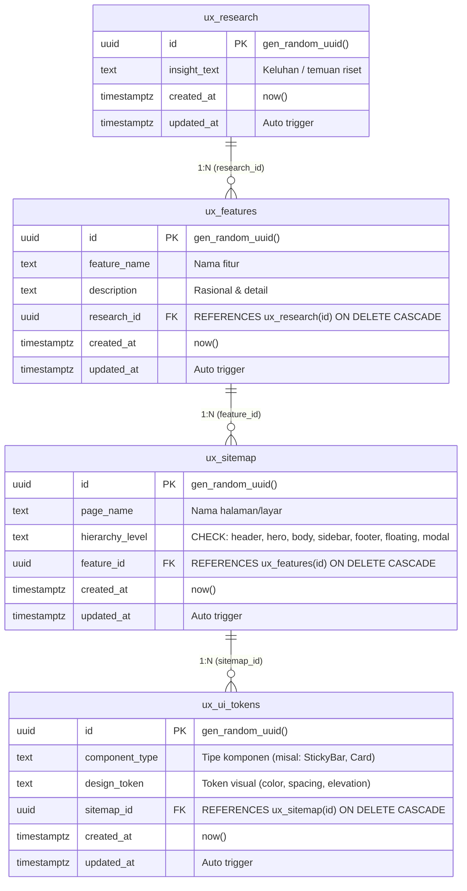

# Panduan Setup & Migrasi Supabase — UX Logic Thread

Dokumen ini berisi panduan teknis implementasi database PostgreSQL pada Supabase untuk produk **UX Logic Thread (Traceability Mapper)**.

---

## 1. Arsitektur Database (4-Tier Traceability Chain)

Database ini mengimplementasikan model relasional hulu-ke-hilir tanpa *data leak* dan tanpa *waterfall queries*.



---

## 2. Struktur File

```text
supabase/
├── production_schema.sql       # Skrip all-in-one siap pakai untuk Supabase SQL Editor (Schema + RLS + Seed Data)
├── migrations/
│   ├── 001_initial_schema.sql  # DDL lengkap (Tabel, Index, Trigger, RLS)
│   └── 002_canvas_edge_disconnect_support.sql # Dukungan unlinked node pada canvas
├── seed.sql                    # Data pengujian 1 alur hulu-ke-hilir lengkap
└── README.md                   # Panduan ini
```

---

## 3. Cara Menjalankan Migrasi di Supabase

### Opsi Paling Cepat (Supabase Web Dashboard — Tanpa CLI)
1. Buka dashboard proyek Supabase Anda di browser ([supabase.com/dashboard](https://supabase.com/dashboard)).
2. Pilih proyek Anda -> Klik menu **SQL Editor** pada sidebar navigasi kiri.
3. Klik tombol **New query**.
4. Buka file [`production_schema.sql`](file:///d:/MindMap/supabase/production_schema.sql), salin seluruh isinya, dan tempel ke SQL Editor Supabase.
5. Klik **Run** (atau tekan `Ctrl+Enter`).
6. Periksa tab **Table Editor** untuk memastikan ke-4 tabel terisi data silsilah logika utuh.

---

### Opsi B: Menggunakan Supabase CLI (Local Development)
Pastikan Docker dan Supabase CLI telah terpasang.

1. **Inisialisasi Proyek (jika belum):**
   ```bash
   npx supabase init
   ```

2. **Jalankan Supabase Lokal:**
   ```bash
   npx supabase start
   ```

3. **Terapkan Migrasi & Seed:**
   ```bash
   npx supabase db reset
   ```
   *Perintah ini otomatis mengeksekusi semua file di `supabase/migrations/` berurutan dan diakhiri dengan `supabase/seed.sql`.*

---

### Opsi C: Menghubungkan CLI ke Remote Project Supabase
1. **Login & Link:**
   ```bash
   npx supabase login
   npx supabase link --project-ref <project-id-anda>
   ```

2. **Push Migrasi:**
   ```bash
   npx supabase db push
   ```

---

## 4. Standar Best Practice yang Diterapkan (`supabase-postgres-best-practices`)

1. **Foreign Key B-Tree Indexing (CRITICAL):**
   - Postgres tidak membuat indeks otomatis pada kolom foreign key.
   - Migrasi ini menyertakan indeks eksplisit:
     - `idx_ux_features_research_id`
     - `idx_ux_sitemap_feature_id`
     - `idx_ux_ui_tokens_sitemap_id`
   - **Manfaat:** Mencegah full table scan saat query relasi `JOIN` bertingkat dan mempercepat operasi `ON DELETE CASCADE` hingga 10-100x.

2. **Row Level Security (RLS) & Akses Publik Terkendali:**
   - RLS diaktifkan (`ALTER TABLE ... ENABLE ROW LEVEL SECURITY`) pada seluruh tabel untuk menjamin isolasi data database-level.
   - Kebijakan (policies) granular untuk operasi `SELECT`, `INSERT`, `UPDATE`, `DELETE` telah dikonfigurasi untuk role `anon` dan `authenticated` sehingga aplikasi MVP dapat langsung beroperasi tanpa konfigurasi auth tambahan yang rumit di awal.

3. **Cascading Integrity (`ON DELETE CASCADE`):**
   - Jika suatu riset dihapus dari hulu, seluruh fitur turunan, node sitemap, dan design token di hilir otomatis dibersihkan secara konsisten tanpa meninggalkan *orphaned rows*.

4. **Automated Timestamp Tracking:**
   - Kolom `updated_at` dimutakhirkan secara otomatis menggunakan trigger fungsi `set_updated_at()` setiap kali baris mengalami mutasi `UPDATE`.

---

## 5. Konfigurasi Environment & Frontend Integration

Tambahkan kredensial Supabase ke file `.env` atau `.env.local` di root proyek:

```env
VITE_SUPABASE_URL=https://<your-project-id>.supabase.co
VITE_SUPABASE_ANON_KEY=eyJhbGciOi...
```

### Contoh Query Bebas N+1 Waterfall (TypeScript)

Gunakan helper types dan query string dari [`src/types/database.types.ts`](file:///d:/MindMap/src/types/database.types.ts):

```typescript
import { createClient } from '@supabase/supabase-js';
import { 
  Database, 
  TRACEABILITY_FULL_SELECT_QUERY, 
  UxResearchTraceabilityTree 
} from './types/database.types';

export const supabase = createClient<Database>(
  import.meta.env.VITE_SUPABASE_URL,
  import.meta.env.VITE_SUPABASE_ANON_KEY
);

// Fetch seluruh rantai jejak logika (1 single database round-trip)
export async function getTraceabilityChain(): Promise<UxResearchTraceabilityTree[]> {
  const { data, error } = await supabase
    .from('ux_research')
    .select(TRACEABILITY_FULL_SELECT_QUERY)
    .order('created_at', { ascending: false });

  if (error) {
    console.error('Failed to load traceability chain:', error);
    throw error;
  }

  return (data ?? []) as unknown as UxResearchTraceabilityTree[];
}
```

### Generate Ulang TypeScript Types (Opsional)
Jika di masa mendatang skema database diubah di dashboard Supabase:
```bash
npx supabase gen types typescript --project-id <your-project-id> > src/types/database.types.ts
```
